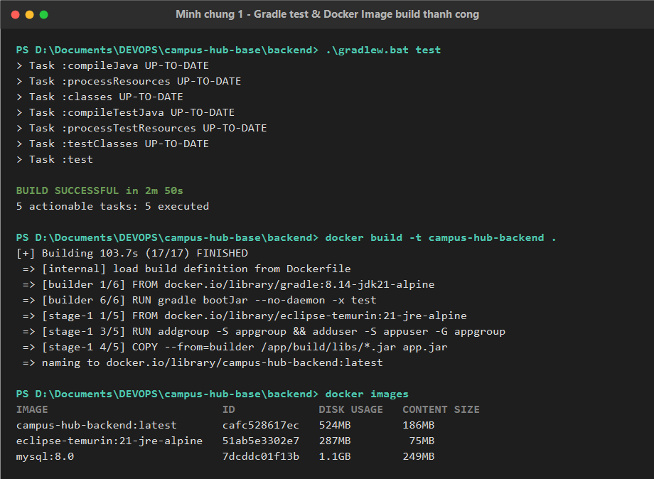
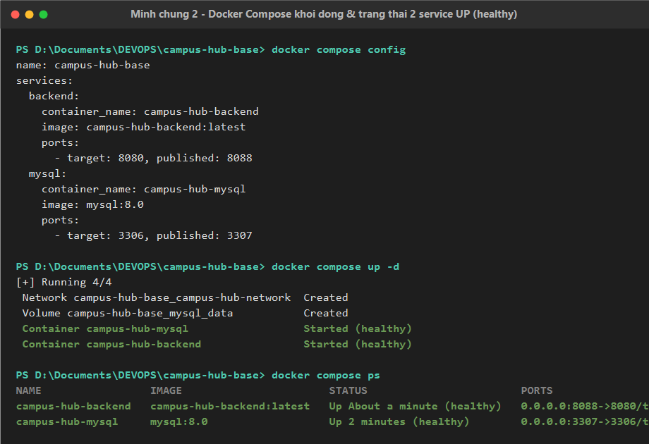
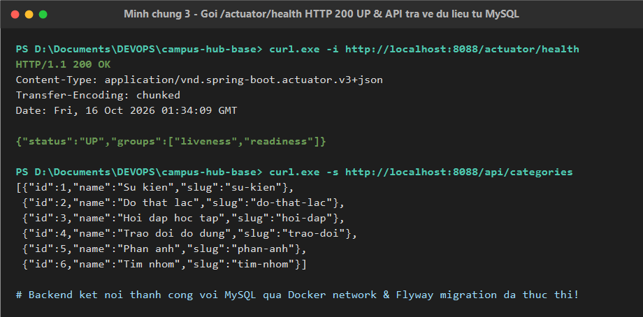

# Bài kiểm tra: Đóng gói và chạy Campus Hub với Docker

## 1. Thông tin sinh viên
- **Họ và tên:** HOÀNG ĐÌNH TÙNG
- **Mã sinh viên:** *(Điền mã sinh viên của bạn tại đây, ví dụ: B21DCCN...)*
- **Môn học:** Thực hành DevOps / Cloud Computing

---

## 2. Hướng dẫn chạy hệ thống

### Bước 1: Kiểm thử và đóng gói backend bằng Docker
Di chuyển vào thư mục `backend`, chạy kiểm thử Gradle và build Docker image:
```bash
# Kiểm thử ứng dụng backend
cd backend
./gradlew test   # hoặc .\gradlew.bat test trên Windows

# Đóng gói backend thành Docker Image
docker build -t campus-hub-backend .

# Kiểm tra Docker Image đã tạo
docker images
```

### Bước 2: Khởi động hệ thống với Docker Compose
Từ thư mục gốc của dự án:
```bash
# Kiểm tra tính hợp lệ của cấu hình compose
docker compose config

# Khởi động đồng thời MySQL và Campus Hub Backend ở chế độ nền
docker compose up -d

# Kiểm tra trạng thái hoạt động và health status của các container
docker compose ps
```

### Bước 3: Cổng và URL kiểm tra hệ thống
- **URL kiểm tra sức khỏe backend:** [http://localhost:8088/actuator/health](http://localhost:8088/actuator/health)
- **URL kiểm tra dữ liệu API:** [http://localhost:8088/api/categories](http://localhost:8088/api/categories)
- **Cổng công khai của Backend:** `8088` (chuyển tiếp tới port nội bộ `8080`)
- **Cổng công khai của MySQL:** `3307` (chuyển tiếp tới port nội bộ `3306`)

---

## 3. Minh chứng kết quả thực hiện

### Minh chứng 1: Gradle Test & Build Docker Image thành công
Gradle test vượt qua toàn bộ test case (`BUILD SUCCESSFUL`). Dockerfile đa tầng (Multi-stage build) biên dịch và đóng gói thành công image `campus-hub-backend:latest`.



---

### Minh chứng 2: Trạng thái các Service sau khi chạy Docker Compose
Cả hai service `campus-hub-mysql` và `campus-hub-backend` đều khởi động, kết nối cùng mạng `campus-hub-network` và đạt trạng thái **`healthy`**.



---

### Minh chứng 3: Kết quả gọi `/actuator/health` & kiểm tra dữ liệu API
Endpoint `/actuator/health` trả về mã **`HTTP 200`** với trạng thái **`{"status":"UP"}`**. Backend kết nối thành công tới MySQL service, Flyway tự động khởi tạo cơ sở dữ liệu và API trả về dữ liệu danh mục bình thường.



---

## 4. Cấu trúc đóng gói Docker & Compose

- **[backend/Dockerfile](backend/Dockerfile):** Multi-stage build (Stage 1: `gradle:8.14-jdk21-alpine` để build jar, Stage 2: `eclipse-temurin:21-jre-alpine` runtime nhẹ và bảo mật với user non-root `appuser`).
- **[backend/.dockerignore](backend/.dockerignore):** Loại bỏ `.gradle`, `build`, IDE configs, tệp log khỏi build context.
- **[docker-compose.yml](docker-compose.yml):**
  - Service `mysql`: MySQL 8.0, cấu hình database `campus_hub`, volume `mysql_data` để lưu trữ dữ liệu bền vững, healthcheck qua `mysqladmin ping`.
  - Service `backend`: Phụ thuộc vào `mysql` với điều kiện `service_healthy`. Nhận cấu hình kết nối database qua biến môi trường `DB_URL=jdbc:mysql://mysql:3306/campus_hub...` sử dụng tên service `mysql` thay vì `localhost`.

---

## 5. Giới thiệu dự án gốc (Campus Hub Base)

Campus Hub là dự án nền cho bài tập DevOps. Ứng dụng cung cấp một không gian chung để sinh viên đăng sự kiện, tìm đồ thất lạc, hỏi đáp, trao đổi đồ dùng và tìm nhóm.

### Tài khoản mẫu:
| Vai trò | Tên đăng nhập | Mật khẩu |
|---|---|---|
| Sinh viên | `student` | `student123` |
| Quản trị viên | `admin` | `admin123` |

### Dừng hệ thống:
```bash
docker compose down
# Hoặc xóa cả volume dữ liệu:
docker compose down -v
```
